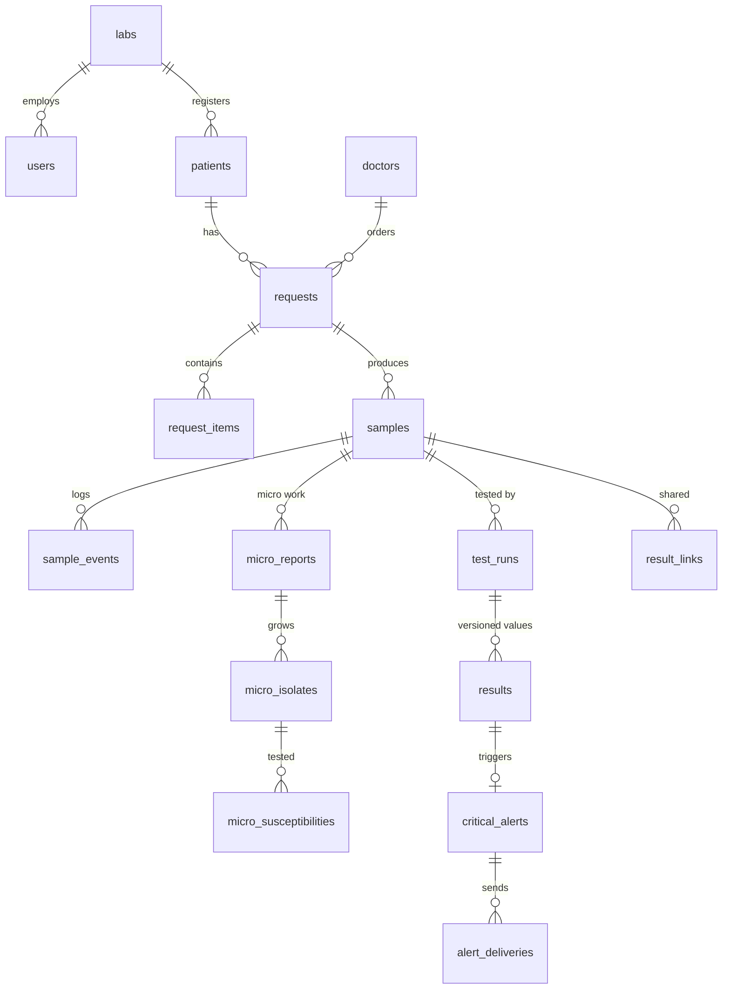

# Aliquot — Database Schema

**Status:** Agreed · 18 Nov 2026 · PostgreSQL 15+ on Supabase

## Global rules
| Rule | Detail | Why |
| --- | --- | --- |
| Primary keys | **UUIDv7** | Time-ordered, so new rows append to the end of the B-tree index (fast inserts, no fragmentation like random UUIDv4); still unguessable in URLs |
| Tenant column | Every lab-owned table has `lab_id NOT NULL` | RLS and tenant scoping |
| Tenant-safe foreign keys | Composite FKs `(lab_id, x_id)` → `(lab_id, id)` | The database itself refuses a row in lab A pointing at lab B's data |
| RLS | `ENABLE` + `FORCE ROW LEVEL SECURITY`, policy `lab_id = current_setting('app.current_lab_id')::uuid` | Second lock behind the API |
| Timestamps | `created_at`, `updated_at` (timestamptz, UTC) | |
| Who did it | `created_by`, `updated_by` → `users` | |
| Deletes | No hard deletes of clinical data; `archived_at` where needed | Medico-legal |
| Money | `bigint` kobo | No float rounding |
| Snapshots | Prices, units and reference ranges are copied onto requests/results at the time of use | Editing the catalogue never changes history |
| Enums | Postgres enums for fixed sets (status, flag, sex, priority, section) | Integrity + small storage |

## Module map
```
tenants ─ staff/auth ─ catalogue ─ patients ─ requests ─ samples ─ results ─ verification
                                                                     │
                                              alerts ─ delivery ─ audit ─ reports
```

---

## 1. Platform & tenants
- **labs** — id, name, slug (subdomain, unique), legal_name, address, phone, email, logo_key, timezone, status (`active`/`suspended`), settings (jsonb: escalation minutes, link expiry days, pay-later allowed), suspended_at
- **lab_sections** — lab_id, section (`chem_path`/`haematology`/`microbiology`), enabled
- **platform_admins** — id, email, password_hash, totp_secret_enc, last_login_at *(no lab_id; no grants on clinical tables)*

## 2. Staff & auth
- **users** — id, lab_id, full_name, email (unique per lab), phone, password_hash, status (`invited`/`active`/`deactivated`), totp_secret_enc, totp_required, last_login_at
- **user_roles** — lab_id, user_id, role (`manager`/`chief_scientist`/`lab_scientist`/`front_desk`)
- **user_sections** — lab_id, user_id, section
- **sessions** — id, user_id, family_id, refresh_token_hash, user_agent, ip, expires_at, revoked_at, replaced_by *(reuse of a revoked token → revoke whole family)*
- **auth_tokens** — id, user_id, purpose (`invite`/`reset`), token_hash, expires_at, used_at

## 3. Catalogue (lab's own copy, seeded from Aliquot defaults)
- **specimen_types** — lab_id, name (Serum, Whole blood, Urine, Swab…), container (Plain, EDTA, Fluoride, Citrate, Heparin, Sterile container)
- **tests** — id, lab_id, section, code (EUCR), name, specimen_type_id, price_kobo, tat_minutes, is_panel, active
- **panel_items** — lab_id, panel_test_id, child_test_id, sort
- **parameters** — id, lab_id, test_id, code (K), name, unit, decimals, value_type (`numeric`/`text`/`choice`), choices (jsonb), formula (for calculated: eGFR, LDL, anion gap), sort
- **reference_ranges** — id, lab_id, parameter_id, sex (`M`/`F`/`any`), age_min_days, age_max_days, low, high, critical_low, critical_high
- **organisms** — lab_id, name, gram (`pos`/`neg`/`n/a`)
- **antibiotics** — lab_id, name, class
- **antibiotic_panels** — lab_id, name (e.g. Gram-negative urine), items → antibiotic_ids
- **rejection_reasons** — lab_id, label

## 4. Patients & doctors
- **patients** — id, lab_id, hospital_no (unique per lab), surname, other_names, sex, date_of_birth, phone, email, address, consent_at, merged_into_id
- **doctors** — id, lab_id, name, phone, facility, ward_or_clinic

*A person seen at two labs is two separate patients. Labs never share patient records.*

## 5. Requests & samples
- **requests** — id, lab_id, lab_no (unique per lab, e.g. `CP-261118-0042`), patient_id, doctor_id, priority (`routine`/`stat`), clinical_details, payment_status (`paid`/`pay_later`), amount_kobo, payment_method (`cash`/`transfer`/`pos`), paid_at, paid_by
- **request_items** — lab_id, request_id, test_id, price_kobo *(snapshot)*, section
- **samples** — id, lab_id, request_id, barcode (unique per lab), specimen_type_id, section, status (`awaiting_collection`/`collected`/`received`/`rejected`/`in_progress`/`resulted`/`released`), collected_at/by, received_at/by, rejected_at/by, rejection_reason, due_at, recollection_of_id
- **sample_events** — lab_id, sample_id, from_status, to_status, at, by, note *(status history; powers the timeline and TAT)*

## 6. Results (chemical pathology & haematology)
- **test_runs** — id, lab_id, sample_id, test_id, status (`pending`/`entered`/`verified`/`released`/`amended`), current_version
- **results** — id, lab_id, test_run_id, parameter_id, version, value_numeric, value_text, unit *(snap)*, ref_low/ref_high/crit_low/crit_high *(snap)*, flag (`N`/`H`/`L`/`CH`/`CL`/`ABN`), is_current, entered_by, entered_at, amend_reason
- **result_comments** — lab_id, test_run_id, kind (`blood_film`/`general`), structured (jsonb), text, version

## 7. Microbiology
- **micro_reports** — id, lab_id, sample_id, test_id, stage (`microscopy`/`culture`/`identification`/`sensitivity`), status (`in_progress`/`preliminary`/`final`), version
- **micro_findings** — lab_id, micro_report_id, kind (`macroscopy`/`microscopy`/`gram_stain`), structured (jsonb), text
- **micro_isolates** — id, lab_id, micro_report_id, organism_id, growth (`scanty`/`moderate`/`heavy`), colony_count
- **micro_susceptibilities** — lab_id, isolate_id, antibiotic_id, result (`S`/`I`/`R`), mic, zone_mm

## 8. Verification
- **verifications** — id, lab_id, sample_id, test_run_id or micro_report_id, kind (`preliminary`/`final`/`amendment`), verified_by, verified_at, comment, reason

## 9. Alerts
- **critical_alerts** — id, lab_id, result_id, sample_id, doctor_id, status (`open`/`acknowledged`), level (1 doctor, 2 chief scientist, 3 manager), acknowledged_by_type/id, acknowledged_at, next_escalation_at
- **alert_deliveries** — lab_id, alert_id, level, channel (`whatsapp`/`sms`/`in_app`), recipient, status, provider_message_id, sent_at, error

## 10. Delivery
- **result_links** — id, lab_id, sample_id or request_id, audience (`patient`/`doctor`), token_hash, expires_at, failed_attempts, locked_until, first_opened_at
- **reports_pdf** — lab_id, sample_id, version, kind (`preliminary`/`final`/`amended`), r2_key, generated_at
- **outbox** — id, lab_id, event_type, payload (jsonb), created_at, processed_at, attempts, last_error
- **messages** — lab_id, channel, recipient, template, status, provider_id, cost_kobo, sent_at

## 11. Audit
- **audit_log** — id, lab_id, actor_type (`user`/`platform_admin`/`system`/`doctor_link`), actor_id, action, entity, entity_id, before (jsonb), after (jsonb), ip, at
*Partitioned by month. Insert-only: no UPDATE/DELETE grants.*

---

## Key indexes
| Table | Index | Serves |
| --- | --- | --- |
| samples | unique `(lab_id, barcode)` | Scan barcode at reception |
| requests | unique `(lab_id, lab_no)` | Lab no. search |
| samples | `(lab_id, section, status, priority, due_at)` | Worklist, already sorted STAT → due |
| test_runs | `(lab_id, status)` partial `WHERE status = 'entered'` | Verification queue |
| patients | GIN trigram on `surname \|\| ' ' \|\| other_names` | Fuzzy name search |
| patients | `(lab_id, phone)`, unique `(lab_id, hospital_no)` | Front desk lookup |
| results | `(test_run_id, parameter_id) WHERE is_current` | Current values |
| results | `(lab_id, patient via test_run, parameter_id, entered_at)` | Previous results / trends |
| critical_alerts | `(next_escalation_at) WHERE status = 'open'` | Escalation sweep |
| outbox | `(created_at) WHERE processed_at IS NULL` | Worker pickup |
| result_links | unique `(token_hash)` | Public link open |
| audit_log | `(lab_id, entity, entity_id, at)` per partition | Audit screen |

## Core relationships

